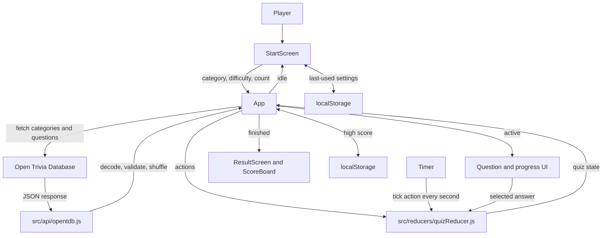
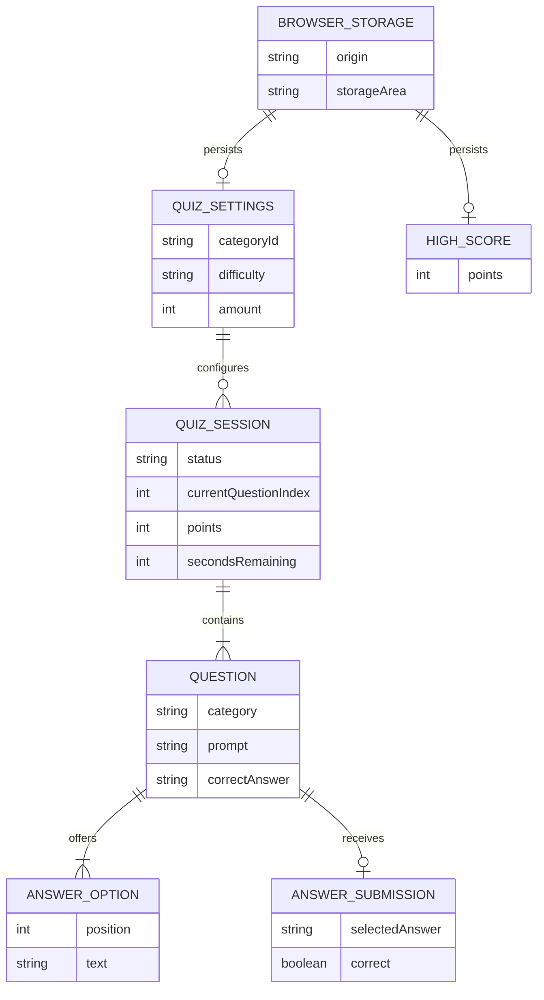

# Quizzy — React Quiz Case Study

## Overview

Quizzy is a playful, responsive trivia app built with React 19 that turns the Open Trivia Database into a configurable, timed quiz: choose a category, difficulty, and question count, answer shuffled multiple-choice questions with immediate feedback, and see your score and personal best at the end. Quiz settings and the high score are saved in the current browser, so there's no account or app backend. **Live demo:** not deployed yet. The app can be run locally using the instructions below; its source is on [GitHub](https://github.com/mahadinamanzo/13-react-quiz).

## Problem → solution

**Problem:** A quiz can feel static or frustrating if questions are hard-coded, answer feedback is delayed, or a failed network request leaves the player unsure what happened.

**Solution:** Quizzy fetches real questions for the player's chosen settings, shuffles the answer options, and uses a reducer to manage each quiz transition. A visible 15-second timer, immediate answer feedback, keyboard controls, loading and error states, and a results screen make the experience responsive and clear. The app remembers the player's last setup and best score in local storage.

## Features

- Choose a trivia category, difficulty, and 5, 10, or 15 questions.
- Load categories and multiple-choice questions from the Open Trivia Database.
- Shuffle answer choices for each question.
- Get immediate correct/incorrect feedback and see the correct answer.
- Answer with the mouse or keyboard: `1`–`4` to choose, `Enter` to continue.
- Race a 15-second timer on each question; the quiz ends when time runs out.
- Track quiz progress, score, and browser-local personal best.
- Remember the last-used quiz settings in the browser.
- Retry category loading or return to setup after a question request fails.
- Use a responsive layout, visible keyboard focus, and live answer announcements.

## Screenshots

Add screenshots to `screenshots/` and replace these placeholders:

| Start screen | Active question | Results |
| --- | --- | --- |
| `screenshots/start-screen.png` | `screenshots/active-question.png` | `screenshots/results.png` |

## Tech stack — and why

| Technology | Why it was used |
| --- | --- |
| React 19 | Split the experience into focused UI components and keep the interface in sync with quiz state. |
| JavaScript (ES modules) | Implement the app without adding a separate build-time type system while learning React patterns. |
| `useReducer`, `useState`, `useEffect`, and `useRef` | Model related quiz transitions centrally, manage small UI state, synchronize timers and requests, and move focus after an answer. |
| Vite 6 and the React plugin | Provide a quick local development server and produce a static production build. |
| CSS Modules and plain CSS | Keep component styles scoped while maintaining control over the responsive visual design. |
| Open Trivia Database | Supply a broad, categorized question set without maintaining a custom question server or database. |
| Browser APIs (`fetch`, `AbortController`, `localStorage`) | Request trivia data, cancel obsolete requests, and persist preferences and the best score without a backend. |

## Architecture



`App.jsx` coordinates the screens and effects. The Open Trivia Database adapter handles requests and normalizes their responses; the reducer owns the quiz lifecycle and scoring rules. Presentational components render setup, question, timer, progress, loading/error, and result states. A shared custom hook reads and writes the two browser-local values.

## Data model

There is no application database. Quiz questions and answers live in React memory for the active session; only quiz settings and the personal-best score are persisted in the browser's local storage.



This diagram describes the app's conceptual state, not database tables. `BROWSER_STORAGE` represents the browser's local storage area: `quizzy-last-settings` and `quizzy-highscore` are separate keys. A submitted answer exists only for the current question and is cleared when moving on; previous answers and quiz history are not saved.

## Security considerations implemented

- Trivia requests use the fixed HTTPS Open Trivia Database endpoint. Query parameters are constructed with `URLSearchParams`, and no API secrets or user credentials are stored in the app.
- The API adapter checks HTTP status, response codes, and expected response fields before using the data. The reducer also checks question and answer invariants before accepting fetched questions or a selected answer.
- API-provided HTML entities are decoded to text and displayed through React text nodes; the app does not render question content with `dangerouslySetInnerHTML`.
- `AbortController` cancels category and question requests when their effect is cleaned up, avoiding stale responses being applied to the current screen.
- Local storage reads and writes are guarded against malformed JSON and browser storage errors. Quiz settings are constrained to known difficulty and question-count values; the high score is checked before display.
- The app is client-only and has no authentication or server-side authorization. Local storage is user-editable and must not be treated as secure storage; the saved score is not authoritative.

## Challenges and what I learned

- **Keeping quiz transitions predictable:** Loading, answering, scoring, timing out, and restarting can interact. A reducer centralizes these transitions and makes invalid actions no-ops.
- **Managing effects safely:** Fetches, intervals, and keyboard listeners need cleanup. `useEffect` cleanup and abort signals prevent stale work, while React Strict Mode helps expose effects that are not safe to repeat in development.
- **Handling external data:** Open Trivia Database returns HTML-encoded strings and status codes within its JSON response. Normalizing the response at the API boundary keeps these details out of the UI.
- **Making the game usable without a mouse:** Keyboard shortcuts, focus movement to the next action, visible focus styles, and live feedback provide a more accessible interaction path.
- **Persisting without a backend:** A small reusable local-storage hook is enough for preferences and a personal-best score, but stored values still need validation and can be changed by the user.

## Future improvements

- Deploy the Vite build and add its public URL above.
- Add automated tests for reducer transitions, API response normalization, and keyboard interactions.
- Keep score history by category and difficulty, while making clear that local scores are device-specific and user-editable.
- Add an option to pause or adjust the per-question timer.
- Add a friendlier empty-state flow for categories with too few available questions.
- Capture real screenshots and add them under `screenshots/`.

## Run locally

```sh
npm install
npm run dev
```

Create and preview a production build:

```sh
npm run build
npm run preview
```

Vite writes the deployable static site to `dist/`.
